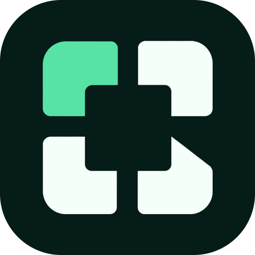

<p align="center"></p>

# NeoOS Services

`neo-os-services` is the NeoOS confidential services stack. It contains the Morpheus-compatible Neo N3 oracle/datafeed protocol, edge and control planes, relayers, Nitro execution workers, the signer custody service, and the operator Web application. The current production design keeps ingress, orchestration, and durability outside the TEE, and reserves confidential VMs for execution only. Key custody is the one deliberate exception (`workers/neo-signer`): a private key, the policy that bounds it, and the ledger that makes a rolling window survive a restart all live inside the enclave's encrypted volume, because a boundary an operator can rewrite from outside is not a boundary — see `docs/SIGNER_SERVICE.md` §4.2 and §6.

`MorpheusOracle`, `MorpheusDataFeed`, `MORPHEUS_*` environment variables, and existing endpoints remain compatibility interfaces for deployed contracts and operators; new repository, package, image, and documentation identities use NeoOS.

Production hosts use `/opt/neoos/services` for code and retain
`/opt/morpheus/nitro` for secrets and runtime state. The tested
`npm run install:code-path-compat` migration creates legacy code-path links only
after validating the canonical checkout and refuses to overwrite existing data.

## Architecture authority

`neo-os-services` owns the NeoDID registry (`protocol-did-registry`): commitments, claims,
nullifiers, and action tickets. Eligibility is an independent proof that the
operation-policy layer composes with AA authorization; the registry never grants
authorization, and an indexer never grants eligibility.

`config/networks` in this repository is the sole source of network identity
(`gateway-network-identity`): magic, genesis, RPC authorities, and signer policy version,
published as the generated network-identities projection that every runtime consumes. No
consumer may restate a magic, genesis, or endpoint as a literal, and a missing or ambiguous
identity fails closed before any write path starts.

The durable service kernel (`gateway-service-kernel`) owns durable jobs, callbacks, and relay
policy: a job is persisted before a cursor advances, retries reuse the same request and
idempotency key, and the delivery store is the completion authority for every delivery
job. Delivery success never implies chain confirmation, and the kernel never replaces AA
authorization or chain finality.

The binding is declared in `neo-os-web/docs/workspace/neoos-target-architecture.v1.json` and
checked by the architecture source-coverage gate.

Proposed v2 binding: in `neo-os-web/docs/workspace/neoos-target-architecture.v2.json` (status `PROPOSED`, validated by `npm run check:architecture:v2` in `neo-os-web`) this repository is v2 layer L3 (gateway) and owns C14 deliver, C15 compute, C16 identity-service and C17 ingress; it also hosts C04 identity and C05 oracle, L1 components pending the move to the protocol repository; C12 sign is bound in `workers/neo-signer/README.md`. The v1 binding above remains the enforced contract until the v2 adoption procedure completes.

## Current Design

1. **Cloudflare edge gateway**
   - public edge entry
   - cache for safe GET routes
   - optional abuse controls
2. **Cloudflare control plane**
   - `POST /mainnet/*` and `POST /testnet/*` ingress
   - auth, validation, rate limit, recovery
   - Cloudflare Queues for `oracle_request` and `feed_tick`
   - Cloudflare Workflows for `callback_broadcast` and `automation_execute`
3. **Supabase durable state**
   - request records
   - control-plane jobs
   - relayer jobs
   - automation runs
   - feed snapshots
   - encrypted refs and operation logs
4. **Confidential execution plane**
   - **Oracle CVM**: `oracle-morpheus-neo-r3e` / `ddff154546fe22d15b65667156dd4b7c611e6093`
   - **DataFeed CVM**: `datafeed-morpheus-neo-r3e` / `ac5b6886a2832df36e479294206611652400178f`
   - Oracle handles confidential request/response work for both mainnet and testnet
   - DataFeed is isolated so continuous price updates are never blocked by slower request workloads

## Canonical Endpoints

- Oracle runtime:
  - `https://oracle.meshmini.app/mainnet`
  - `https://oracle.meshmini.app/testnet`
- Edge gateway:
  - `https://edge.meshmini.app/mainnet`
  - `https://edge.meshmini.app/testnet`
- Control plane:
  - `https://control.meshmini.app/mainnet`
  - `https://control.meshmini.app/testnet`
- Oracle attestation verification:
  - in-app `POST /api/attestation/verify` (or the `/verifier` page)
- DataFeed attestation verification:
  - in-app `POST /api/attestation/verify` (or the `/verifier` page)

## Active Scope

- Neo N3 is the active supported production path.
- Network selection is path-based and config-based, not CVM-based.
- Pricefeeds are operator-driven and highest priority.
- Oracle and compute requests are asynchronous and callback-based.

## On-Chain MiniApp OS

- `MorpheusOracle` keeps its legacy deployment name, but the contract role is now a shared MiniApp OS kernel.
- The kernel owns miniapp registration, module registration, capability grants, request routing, inbox delivery, fee credits, and generic app state.
- `MorpheusDataFeed` is treated as a built-in shared numeric resource module.
- `OracleCallbackConsumer` is now an optional external adapter for advanced integrations, not a mandatory per-miniapp primitive.
- The intended integration model is `miniapp-os + miniapps`: generic concerns stay in the system, while miniapps focus on business logic and configuration.

## Network Registry

- `config/networks/mainnet.json` is the canonical mainnet registry.
- `config/networks/testnet.json` is the canonical testnet registry.
- `nitro.request-hub.toml` points to the Oracle CVM launcher.
- `nitro.feed-hub.toml` points to the DataFeed CVM launcher.
- `deploy/nitro/morpheus.mainnet.env` and `deploy/nitro/morpheus.testnet.env` are generated local env files and must remain uncommitted.
- `scripts/export-public-network-registry.mjs` emits the canonical public network registry for consumer repos.
- `scripts/export-public-runtime-catalog.mjs` emits the public workflow and envelope catalog for consumer repos.

## Repository Layout

- `apps/web` — Next.js dashboard, docs, explorer, and backend routes used by the control plane
- `workers/nitro-worker` — confidential execution runtime
- `workers/morpheus-relayer` — on-chain async bridge and callback relayer
- `workers/neo-signer` — key custody service; a Rust crate, in `workers/` because that is where this repository keeps confidential-plane processes, and deliberately not an npm workspace member
- `deploy/cloudflare` — edge gateway and control-plane workers
- `contracts` — Neo N3 MiniApp OS kernel and built-in modules
- `supabase/migrations` — schema, policies, control-plane jobs, relayer durability
- `docs` — canonical architecture, deployment, operations, validation, and specs
- `scripts` — deployment, verification, SaaS sync, and operator helpers

## Repository boundary

This repository owns the NeoOS confidential services stack, and with it **key custody**:
the signer service, its key policy, its caller registry, and its audit trail. The
contract and ownership rules are in `docs/SIGNER_SERVICE.md`.

| Repository               | Responsibility                                                                                                                                                     |
| ------------------------ | ------------------------------------------------------------------------------------------------------------------------------------------------------------------ |
| `neo-os-services`        | Oracle, DataFeed, VRF, Compute, Paymaster, confidential runtimes, **the signer service**                                                                           |
| `neo-os-web`             | Host shell, MiniApp catalog, edge gateway, wallet/session boundary, deployment tooling                                                                             |
| `neo-os-contracts`       | Neo N3 platform contracts, manifests, build and deployment evidence                                                                                                |
| `neo-os-devpack`         | App-facing framework, shared runtime, types, generated service catalogs                                                                                            |
| `neo-os-explorer`        | Read APIs and relayer submission                                                                                                                                   |
| `secure-sign-service-rs` | Enclave backends: NEP-6 sealing, Nitro KMS attestable start (the deployed TEE), SGX mode (not deployed), consensus policy                                          |
| `neo-nexus`              | **Consumer.** Operator console, runtime config generation, launch packs, endpoint pinning, health probes. It must not hold, derive, export or accept a private key |

The rule: a signing key the **platform** uses lives here and nowhere else. Wallets the
user holds in `neo-os-app` are the user's own and never the service's keys. Before
adding a signing call site anywhere in the workspace, read `docs/SIGNER_SERVICE.md` §7 —
call sites that hold a WIF today are listed there as work to retire, not as a pattern.

## Built-In Compute

The compute catalog currently exposes built-ins for:

- hashes and signature verification
- modular arithmetic and matrix/vector math
- Merkle helpers
- ZKP planning and Groth16 verification helpers
- FHE planning helpers
- privacy masking and noise helpers

The catalog is designed so additional runtimes can be added later without changing the on-chain request model.

## Quick Start

```bash
npm install
cp .env.development.example .env.local
npm run test:worker
npm run test:relayer
npm run dev:web
```

## Core Verification Commands

```bash
npm run verify:repo
npm run check:audit:root
npm run test:worker
npm run test:relayer
npm run test:control-plane
npm run build:web
npm run smoke:control-plane
npm run smoke:n3
npm run check:signers
MORPHEUS_NETWORK=testnet npm run verify:n3
```

## Root Audit Baseline

`npm run verify:repo` is the preferred local verification entrypoint for this repository.
Its stale Next.js builder cleanup uses `pgrep` when available and is a quiet no-op on
Windows Git Bash installations that do not provide procps; the verification gates
themselves remain identical.

`npm run check:audit:root` is the canonical root production dependency audit gate.

The current accepted root baseline is the explicitly excluded CityOfZion / Neon chain:

- `@cityofzion/neon-js`
- `@cityofzion/neon-core`
- `@cityofzion/neon-api`
- transitive `elliptic`
- transitive `lodash`

That command enforces no additional production vulnerabilities beyond the excluded CityOfZion baseline and fails if the excluded package set changes unexpectedly.

Targeted regression commands:

```bash
npm run examples:test:n3:callback-boundary
npm run examples:test:n3:neodid-registry-boundary
npm run examples:test:n3:neodid-registry-v1
npm run examples:test:n3:encrypted-ref-boundary
npm run examples:test:n3:fulfillment-replay
npm run examples:test:n3:aa-session-oracle-boundary
npm run examples:test:n3:attack-regression
```

## Documentation

- `docs/ARCHITECTURE.md`
- `docs/MINIAPP_OS_AUDIT.md`
- `docs/DEPLOYMENT.md`
- `docs/OPERATIONS.md`
- `docs/VALIDATION.md`
- `docs/ENVIRONMENT.md`
- `docs/ASYNC_PRIVACY_ORACLE_SPEC.md`
- `docs/ATTESTATION_SPEC.md`
- `docs/USER_GUIDE.md`
- `docs/RELAYER.md`
- `docs/PROVIDERS.md`
- `docs/PAYMASTER.md`
- `docs/SIGNER_SERVICE.md`
- `docs/BUILTIN_COMPUTE.md`
- `docs/EXAMPLES.md`
- `docs/SAAS_STACK_INTEGRATION.md`
- `deploy/nitro/README.md`
- verifier UI: `/verifier`
