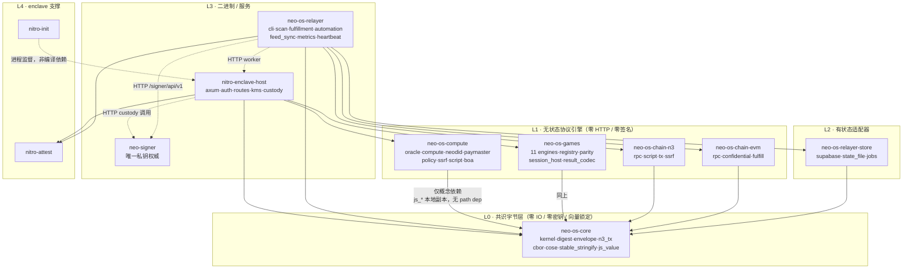
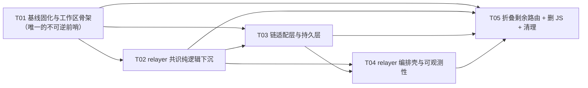

# 《neo-os-services 后台服务 Rust 化迁移架构设计》

架构师：高见远　|　版本：v1.0　|　依据：实际读码（含 `cargo test --workspace` 实跑）

---

## 0. 执行摘要：先纠正三个关键前提

我实际读了代码并跑了测试，有三点与起步盘点不一致，**这三点直接改变任务量与风险排序**：

| #   | 原假设                                                    | 实测结论                                                                                                                                                                                                                                                                                                                                                                | 影响                                                         |
| --- | --------------------------------------------------------- | ----------------------------------------------------------------------------------------------------------------------------------------------------------------------------------------------------------------------------------------------------------------------------------------------------------------------------------------------------------------------- | ------------------------------------------------------------ |
| 1   | `morpheus-relayer-rs` "只有基础骨架，逻辑远未覆盖"        | 它不只是骨架，是**已废弃的死代码**：521 行，依赖 `napi`/`napi-derive`/`config=0.14`，`lib.rs` 文档声称有 chains/processor/queue/automation/feed/persistence/monitoring 七个模块但**一个都不存在**。命名仍是 Morpheus，带 Node FFI 桥                                                                                                                                    | 不要在其上扩展，**推倒重来**                                 |
| 2   | `crates/morpheus-compute` 是"用 boa 做 JS 沙箱的 compute" | 它已经 **28323 行**，包含：11 个游戏引擎全量移植 + registry + parity driver、整个 oracle 面（crypto 2107 / providers 2137 / message_reveal 1819 / fetch 1074 / feeds 1121 / aggregation / feed_registry / decimal）、neodid 1945、paymaster 1454、compute 1928、platform 守卫全套（policy/overload/circuit_breaker/risk/permission/ssrf/capabilities/stable_stringify） | nitro-worker 的**主体已经迁完**。剩余是 6 条路由 + host 适配 |
| 3   | 迁移 ≈ 5 万行从零写                                       | Rust 侧现有 **70355 行 / 910 个测试全绿**（morpheus-compute 357、neo-signer ~257、nitro-enclave-host 197、morpheus-core 48、nitro-attest ~24、nitro-init 12、relayer-rs 9）。enclave EIF **已经是 Rust-only**（`deploy/nitro/Dockerfile.enclave` 只有 `enclave_host` + `nitro_init` 两个 Rust 二进制，无 Node）                                                         | 剩余净新增≈**1.5 万行**，不是 5 万行                         |

另外一个容易漏掉的第三块迁移面：`deploy/nitro/enclave-server.mjs`（2106 行）——它是**拆分前的合并 Node enclave 服务**，已由 `nitro-enclave-host` 取代，Dockerfile 注释明确它只是"从 git 历史重建 EIF 的回滚资产"。所以它**不在本次重写范围**，只需在 T05 加头部说明。

`workers/nitro-worker` 的真实定位（`docs/RUST_SERVICE_MIGRATION.md` 原文）："remains a compatibility runtime for container/CVM deployments and the JavaScript parity oracle while migration gates still consume its vectors. It is not packaged into the measured Rust EIF."

**结论：这不是"从零重写 5 万行"，而是"补完最后 6 条 enclave 路由 + 重建 relayer 编排壳 + 安全拆除 JS"。风险不在工作量，在拆除顺序。**

---

## 1. 现状审计：模块清单与去重判定

### 1.1 workers/morpheus-relayer（实现 11,691 行 / 测试 10,769 行）

| 模块                                                                           | LOC  | 职责一句话                                                                                                        | Rust 现状                                                                         | 判定                              |
| ------------------------------------------------------------------------------ | ---- | ----------------------------------------------------------------------------------------------------------------- | --------------------------------------------------------------------------------- | --------------------------------- |
| `router.js`                                                                    | 739  | kernel intent 路由表、fulfillment digest、on-chain result envelope、compact callback 编解码                       | **已移植** — `morpheus-core::{kernel,digest,envelope}` + 8 个向量文件             | 删                                |
| `lib/strings.js`                                                               | 43   | `trimString` / `normalizeRequestType` / `strip0x`                                                                 | **已移植** — `kernel::normalize_request_type`                                     | 删                                |
| `config-schema.js`                                                             | 914  | 109 个逻辑 key / 149 个 env 名的声明式清单（别名链 + 优先级 + 脱敏标记）                                          | 无                                                                                | **净新增**（纯逻辑，T02）         |
| `config.js`                                                                    | 777  | `createRelayerConfig()` — 别名链解析、RPC URL 排序、fail-closed 开关                                              | 无                                                                                | **净新增**（T02/T03）             |
| `config-introspect.js`                                                         | 314  | `config:validate` / `config:dump`，含脱敏与条件必填                                                               | 无                                                                                | **净新增**（T02/T04）             |
| `neo-n3.js`                                                                    | 1130 | Neo N3 事件扫描（block window / n3index / request cursor）、交易构建签名广播、feed 记录读取                       | 仅 feed 脚本在 `n3_tx.rs`                                                         | **净新增**（T03，最大块）         |
| `neox.js`                                                                      | 547  | NeoX EVM 扫描、confidential envelope 解码、digest、签名、receipt 等待、revert 归一化                              | `neox_digest.json` 向量已覆盖 digest                                              | **净新增**（T03）                 |
| `persistence.js`                                                               | 747  | Supabase REST：6 张表的 upsert/patch/claim/quarantine/fetch，配额与连通性错误分类 + 退避                          | 无                                                                                | **净新增**（T03）                 |
| `queue.js`                                                                     | 669  | durable queue 的 hydrate / 背压 defer / 乐观并发 claim / 低于 request floor 的隔离                                | 无                                                                                | **净新增**（T03）                 |
| `automation.js`                                                                | 914  | automation 控制请求（创建/暂停/恢复/取消）与到期作业处理                                                          | 无                                                                                | **净新增**（T04）                 |
| `state.js`                                                                     | 483  | 状态文件 schema、metric 计数、retry 调度与退避、队列限额                                                          | 无                                                                                | **净新增**（T02）                 |
| `request-processor.js`                                                         | 391  | 逐链处理编排：新事件过滤、pending reconcile、cursor 解析                                                          | 无                                                                                | **净新增**（T04）                 |
| `fulfillment/*` (7)                                                            | 1992 | executor（事件富化/解密绑定构造）、coordinator、dispatch（重试/耗尽/终态）、delivery、signer、enclave、classifier | digest/envelope 已在 core                                                         | **净新增**（T04，编排部分）       |
| `feed-sync.js`                                                                 | 204  | feed 同步编排与下次延迟计算                                                                                       | 无                                                                                | **净新增**（T04）                 |
| `prometheus.js`                                                                | 172  | 25 个 counter + labeled counter 的 Prometheus 文本渲染                                                            | 无                                                                                | **净新增**（T04，**契约硬约束**） |
| `attestation.js`                                                               | 339  | Nitro COSE_Sign1 证明验证 + 证书链到 pinned root + PCR0 比对                                                      | `morpheus-core::cose` 已覆盖 Sig_structure/ES384→DER；证书链部分需 `nitro-attest` | 部分新增（T04）                   |
| `custody.js` / `nitro.js` / `heartbeat.js`                                     | 179  | 签名托管客户端 / worker HTTP 客户端 / Betterstack 心跳                                                            | 无                                                                                | **净新增**（T03/T04）             |
| `logger.js` / `metrics-server.js` / `healthcheck.js` / `cli.js` / `relayer.js` | 546  | 结构化日志、metrics HTTP server、state 新鲜度检查、CLI、tick 编排                                                 | 无                                                                                | **净新增**（T04）                 |

**去重结论**：relayer 的**共识字节层（digest / envelope / kernel intent / compact callback / Neo feed 脚本 / CBOR-COSE / stableStringify / error codes）已经在 `crates/morpheus-core` 里，并由 `scripts/export-rust-vectors.mjs` 从 JS oracle 导出 8 个向量文件做 byte-parity**。这部分**不要重写，直接复用**。真正净新增的是"编排 + IO + 配置"约 9,000 行。

### 1.2 workers/nitro-worker（实现 16,503 行 / 测试 11,485 行）

| 模块                                                                                                                     | LOC   | 职责一句话                                                                              | Rust 现状                                               | 判定                    |
| ------------------------------------------------------------------------------------------------------------------------ | ----- | --------------------------------------------------------------------------------------- | ------------------------------------------------------- | ----------------------- |
| `capabilities.js`                                                                                                        | 537   | 30 条能力的路由表与 resolver（path 优先，action 兜底）                                  | **已移植** `capabilities.rs`(380)                       | 删                      |
| `worker.js` / `server.js`                                                                                                | 435   | HTTP 壳：网络前缀注入、免鉴权探针、guard/overload、执行计划与结果信封                   | **已移植** `nitro-enclave-host`                         | 删                      |
| `platform/core.js`                                                                                                       | 421   | env 别名链、网络 scoped env、SSRF RPC 校验、错误脱敏、JSON 路径、时长解析               | **已移植** `core.rs`(1075)                              | 删                      |
| `platform/{ssrf,policy-engine,overload-guard,circuit-breaker,risk-observer,permission-guard,allowlist,stable-stringify}` | 1248  | 各类守卫与稳定序列化                                                                    | **已移植**                                              | 删                      |
| `platform/{auth,custody}.js`                                                                                             | 152   | 承载令牌鉴权、签名托管客户端                                                            | **已移植** `nitro-enclave-host::{auth,custody}`         | 删                      |
| `platform/script-{runner,source,policy}.js` + `standalone.rs`                                                            | 312   | JS 沙箱 / WASM（**失败关闭**）                                                          | **已移植** `script.rs`(803) + `standalone.rs`(308)      | 删                      |
| `platform/nitro-signer.js`                                                                                               | 272   | AWS Secrets Manager + 派生密钥 + dstack 证明                                            | **已被 KMS release 取代**（Rust 侧不调 GetSecretValue） | 删                      |
| `oracle/crypto.js`                                                                                                       | 772   | X25519+HKDF-SHA256+AES-256-GCM v2 信封                                                  | **已移植** `oracle/crypto.rs`(2107)                     | 删                      |
| `oracle/{fetch,aggregation,providers,feed-registry}.js`                                                                  | 1724  | 上游抓取、多源聚合、provider 健康、feed 注册表                                          | **已移植**                                              | 删                      |
| `oracle/feeds/{shared,sync-policy,neo-stack-decode,decimal}.js`                                                          | 1009  | feed 提交策略、Neo stack item 解码、定点小数                                            | **已移植** `oracle/{feeds/*,decimal}`                   | 删                      |
| `oracle/message-reveal.js`                                                                                               | 202   | 时间锁消息揭示 + EIP-191 恢复                                                           | **已移植** `message_reveal.rs`(1819)                    | 删                      |
| `compute/index.js`                                                                                                       | 869   | 20 个内建函数 + standalone 通道                                                         | **已移植** `compute.rs`(1928)                           | 删                      |
| `neodid/index.js`                                                                                                        | 855   | DID 绑定 / action ticket / recovery ticket                                              | **已移植** `neodid.rs`(1945)                            | 删                      |
| `paymaster/index.js`                                                                                                     | 369   | gas 代付授权                                                                            | **已移植** `paymaster.rs`(1454)                         | 删                      |
| `game/engines/*` + `wrappers/*` + `registry.js`                                                                          | 2,910 | 11 个游戏引擎 + hash-pinned 注册表                                                      | **已移植** `game/*`（含 parity driver）                 | 删（**有前置，见 §4**） |
| **`game/session.js`**                                                                                                    | 623   | 通用会话主机：identity canonical、HMAC 根、79 字节 RESULT CODEC、行为门禁、replay proof | **无**                                                  | **净新增（最高风险）**  |
| **`oracle/vrf.js`**                                                                                                      | 40    | CSPRNG 32 字节 + 签名信封                                                               | **无**                                                  | **净新增**              |
| **`oracle/feeds/feed-state.js`**                                                                                         | 230   | feed 快照的 Supabase + 磁盘持久化与陈旧度观测                                           | **无**                                                  | **净新增**              |
| **`oracle/feeds/feed-submit.js`**                                                                                        | 386   | feed 上链提交（含时间戳钳制与签名字段）                                                 | 部分（sync_policy 已移植）                              | **净新增**              |
| **`platform/request-guards.js`**                                                                                         | 458   | 幂等 + 分布式锁 + deadline                                                              | **无**                                                  | **净新增**              |
| **`platform/upstash.js`**                                                                                                | 158   | Upstash Redis REST（分布式锁/幂等，fail-closed 开关）                                   | **无**                                                  | **净新增**              |
| `chain/{index,neo-n3,signing}.js`                                                                                        | 838   | relay / sponsor / broadcast / 签名信封                                                  | 部分（feed 脚本已在 core）                              | **部分新增**            |
| `platform/{execution-plan,result-envelope,wasm-runner,script-policy}.js`                                                 | 328   | 执行计划归一化、结果信封、WASM（失败关闭）                                              | 部分                                                    | 部分新增                |

**去重结论**：nitro-worker 的**计算/Oracle/game 引擎主体已经全量落在 `morpheus-compute` + `nitro-enclave-host`**。剩余净新增约 **4,500 行**，集中在表里加粗的 6 个模块 + 6 条未折叠路由的 host 适配。

`docs/RUST_SERVICE_MIGRATION.md` 与
`docs/rust-migration/SERVICE_CONTRACT_MATRIX.md` 是当前权威：`/session/*`、
`/vrf/random`、`/paymaster/authorize`、`/neodid/zklogin-ticket`、
`/automation/execute`（已 claim 的单次 adapter）和 `/oracle/feed`
（观测/聚合/策略 adapter）已在 `nitro-enclave-host` 落地。Durable
relayer scheduler 仍未实现；`workers/morpheus-relater-rs` 已从活跃
workspace 退役，不得当作生产 relayer。

### 1.3 packages/shared（4,615 行）

| 模块                                                                                                                                                                | LOC                                                                                             | 判定                                                                                              |
| ------------------------------------------------------------------------------------------------------------------------------------------------------------------- | ----------------------------------------------------------------------------------------------- | ------------------------------------------------------------------------------------------------- |
| `error-codes.js` (297)                                                                                                                                              | → **已移植** `morpheus-core::error_codes`                                                       | 保留给 apps/web 与 scripts，Rust 侧已有权威实现                                                   |
| `cbor.js` (231) / `cose-verify.js` (92)                                                                                                                             | → **已移植** `morpheus-core::{cbor,cose}`                                                       | 同上                                                                                              |
| `utils.js` (168) 含 `stableStringify`                                                                                                                               | → **已移植**（morpheus-core 与 morpheus-compute 各一份本地副本）                                | 同上                                                                                              |
| `neo-encoding.js` (40)                                                                                                                                              | → **已移植** `neo_encoding.rs`                                                                  | 同上                                                                                              |
| `confidential-envelope.js` (313)                                                                                                                                    | 客户端编码器；**Rust 解密端是权威**（`morpheus-compute::oracle::crypto`），文件头注释已如此声明 | **保留不动**——它是 devpack / abstract-account / apps/web 的下游 vendor 源，动它会波及三个外部仓库 |
| `neo-signers-core.js` (483)                                                                                                                                         | 签名者角色 pin，被 relayer 与 ops 脚本共用                                                      | 随 relayer 下沉（T02）                                                                            |
| `logger/` (296)                                                                                                                                                     | 结构化日志                                                                                      | 随 relayer 下沉（T04）                                                                            |
| `workflow-catalog.js` / `public-runtime.js` / `rate-limit.js` / `node-runtime.js` / `callback-methods.js` / `credential-separation.js` / `automation-supervisor.js` | apps/web 与 scripts 仍在用                                                                      | **保留不动**                                                                                      |

**去重结论**：shared 里**纯逻辑已 100% 下沉**；剩下的是 apps/web 与 scripts 的活依赖，**不能删**。

### 1.4 关于 Q4（Oracle 与加密是否重复）

**不重复，且已有权威的 ownership 划分，**`docs/CRYPTO_OWNERSHIP.md` 是 145 行的成文规范，`scripts/check-rust-migration.mjs` 从结构上强制它：

- `morpheus-core` —— 只做确定性共识编码/哈希/信封构造，**禁止**依赖 aes-gcm / curve25519-dalek / hkdf（门禁直接 grep Cargo.toml 与 `mod confidential`）
- `morpheus-compute::oracle::crypto` —— **权威**的 X25519-HKDF-SHA256-AES-256-GCM v2 信封、sealed keystore、encrypted-ref claim（旧 `morpheus-core::confidential` 已被删除，门禁断言该文件不存在）
- `neo-signer::crypto` —— **不同协议**：Neo N3 P-256 签名、verification script、script hash、地址、NEP-2。与 oracle 信封无交集
- `nitro-attest` —— Nitro 证明验证、KMS release、CMS 解密（仅 KMS 内部细节，不做应用层加密 API）
- `nitro-enclave-host` —— 只组合，不得持有第二份协议实现；门禁断言 `compute_execute.rs` 必须 `use morpheus_compute::oracle::crypto`

`workers/nitro-worker/src/oracle/crypto.js` 是**迁移夹具**，不是重复实现——文件头注释与 CRYPTO_OWNERSHIP.md 都写明"compatibility code is not production authority"。**无需收敛动作。**

---

## 2. 目标架构：crate 拓扑

### 2.1 最终 workspace 成员（12 个）

```
crates/neo-os-core          ← 更名自 morpheus-core      4.0k行  共识字节层，零 IO、零密钥
crates/neo-os-compute       ← 更名自 morpheus-compute   23.8k行  Oracle / compute / NeoDID / paymaster / platform 守卫
crates/neo-os-games         ← 新增（自 morpheus-compute/src/game 拆出） 4.5k行  11 引擎 + registry + parity + session host
crates/neo-os-chain-n3      ← 新增                      ~1.2k行  Neo N3 JSON-RPC + 脚本/交易/广播 + n3index + SSRF
crates/neo-os-chain-evm     ← 新增                      ~0.8k行  NeoX EVM RPC + confidential 解码 + fulfill + revert
crates/neo-os-relayer-store ← 新增                      ~0.9k行  Supabase REST + 状态文件 + durable queue schema
crates/nitro-attest         ← 不变                      2.4k行   Nitro 证明 / KMS / CMS
crates/nitro-init           ← 不变                      0.9k行   enclave PID 1 监督
workers/neo-signer          ← 不变                      21.9k行  唯一私钥托管与签名权威
workers/nitro-enclave-host  ← 扩展                      12.3k行+ HTTP 前沿、鉴权、路由、KMS 物化、托管调用
workers/neo-os-relayer      ← 新增（替换 morpheus-relayer-rs） ~4k行  编排壳：扫描 / fulfillment / automation / feed / 可观测性
```

**关于更名**：既有 crate 更名需用户拍板。评估是 **morpheus-core / morpheus-compute 更名成本极低**（只改 3 个 Cargo.toml 的 path 依赖 + `nitro-enclave-host` 的 use 路径 + Dockerfile.enclave 的 6 行 COPY + `check-rust-migration.mjs` 的 5 个路径常量），收益是消除"新代码不得用 morpheus"这条规则的持续例外。

### 2.2 依赖图



实线 = 编译期 path 依赖；虚线 = 运行期 HTTP / 进程关系。

### 2.3 关键拓扑决策与理由

**决策 1：把 game lane 从 morpheus-compute 拆出为 `neo-os-games`**
28k 行的单 crate 已经逼近"上帝 crate"。拆分依据不是行数，而是**变更节奏与风险剖面完全不同**：引擎是"内容"，按游戏逐个人工评审、hash-pinned、goldens 是共识级资产；Oracle lane 是"协议"，按上游 provider 变化演进。混在一起意味着改一个数独规则要重链整个 Oracle 面，且 parity goldens 的 drift 信号被无关 churn 淹没。成本只有 `nitro-enclave-host/Cargo.toml` 加一行 path dep + `Dockerfile.enclave` 加两行 COPY。

**决策 2：不把 morpheus-compute 继续切碎**
剩下的 23.8k 行内部模块树已经很干净（oracle / compute / neodid / paymaster / platform 五组），再切只会增加 path dep 与版本耦合。enclave 镜像要求 `--locked` 可复现构建，crate 粒度越粗构建图越稳。

**决策 3：relayer 拆成 4 个 crate 而不是一个**
relayer 是本次唯一"从零写 4k 行"的部分。拆成 `chain-n3` / `chain-evm` / `relayer-store` / `relayer` 的理由是**IO 边界必须可测**：三个适配层全部走注入 transport，`cargo test` 不触网；编排壳只剩纯状态机，可以用录制事件回放。如果塞进一个 crate，测试必然开始打真实 RPC 或写真实 Supabase，这是"直接重写替换"策略最容易翻车的地方。

**决策 4：澄清并修正"workspace 禁止成员间 path 依赖"这条规则**
`crates/morpheus-compute/src/lib.rs` 与 `js.rs` 的注释声称"workspace rule forbids path dependencies between members"，但**根 `Cargo.toml` 里根本没有这条规则，且实践已违反**：`nitro-enclave-host` 依赖 morpheus-compute / morpheus-core / nitro-attest，`neo-signer` 依赖 morpheus-core / nitro-attest。这条注释误导性很强——它是 `js.rs` 与 `stable_stringify.rs` 在 morpheus-compute 里**重复实现** morpheus-core 已有能力的理由，而重复正是 drift 的温床。

**建议**：把规则改写为准确版本 —— \_"库 crate（L0/L1/L2）之间可以有 path 依赖；只有 `js\__`语义助手允许本地副本，且必须标注 drift 风险"\*，并在 T01 顺手把`morpheus-compute::stable_stringify`改为`use morpheus_core::stable_stringify`，消掉一处真实的重复实现。

---

## 3. 关键技术决策与取舍

### 3.1 boa_engine 与 vendor patch：**保留，不能摘**

- `boa_engine` 是**真需求**：`/compute/execute` 的 user-supplied JS 通道。`crates/morpheus-compute/src/script.rs` 已经用 boa 在进程内替换掉了 JS 的 `script-child.cjs` 多进程沙箱（803 行）。`apps/web` 有 `/api/compute/execute` 路由，链上有 script 请求类型 —— **这是产品能力，不是迁移夹具**。
- vendor patch 仍必需：`vendor/boa_engine-0.21.1/Cargo.toml` 里 `icu_normalizer` pin `~2.0.0`，而 `stableStringify` 用的 `icu_collator 2.3.1` 需要 `~2.3.0`。Cargo.lock 现状是 `icu_normalizer 2.3.0` + `icu_collator 2.3.1` 统一在 2.x，正是 patch 的效果。

**摘除的前置条件（三选一，都代价高昂）**：

1. 放弃 user-JS 脚本通道（产品决策，会破坏已部署调用方）
2. 把 `stableStringify` 的 ICU 'en' collation 换成自实现 UCA —— **强烈反对**，它是 `output_hash` 的输入，共识级函数，自己实现 collation 等于主动引入一个 consensus 分叉源
3. 升级到 boa 0.22+（若其 ICU4X pin 已对齐 2.x）—— 需要重新验证整个脚本沙箱语义

**结论：vendor patch 保留。T01 只做一件事——把"为什么不能摘"写进 `Cargo.toml` 注释的显眼位置和 `docs/RUST_SERVICE_MIGRATION.md`，防止后人误摘。**

### 3.2 Rust 侧技术选型

| 关注点                 | 选型                                                 | 理由                                                                                                                                                                              |
| ---------------------- | ---------------------------------------------------- | --------------------------------------------------------------------------------------------------------------------------------------------------------------------------------- |
| async 运行时           | `tokio`（`nitro-enclave-host` 已在用）               | enclave 镜像要求可复现；引入第二个运行时会让 PCR 构建图复杂化                                                                                                                     |
| HTTP server（enclave） | `axum 0.8`（已在用）                                 | 同上                                                                                                                                                                              |
| HTTP client            | `reqwest 0.12` + `rustls-tls` + `blocking`（已在用） | 避开 OpenSSL 的 C 依赖，利于可复现构建；enclave 内走 `HTTPS_PROXY` → vsock → host allowlist proxy                                                                                 |
| JSON                   | `serde_json` **必须开 `preserve_order`**             | JS 对象保插入序，响应体字节对比会被 BTreeMap 默认排序静默破坏。现有 crate 已正确配置                                                                                              |
| JS 数字语义            | `morpheus-core::{js_number,js_json,js_value}`        | JS double 的 `JSON.stringify` 输出与 Rust 默认不同（`1.0`→`1`、`1e21`→`1e+21`、NaN/Inf→`null`），这是 hash 漂移的头号来源                                                         |
| EVM                    | **`alloy`（推荐）** 而非 `ethers-rs`                 | 纯 Rust，无 C 依赖，对 `--locked` 可复现构建更友好。`ethers-rs` 的 `ethers-core` 会引入 `openssl`/`secp256k1` 的 C 构建路径                                                       |
| Neo N3                 | 自写 JSON-RPC + `morpheus-core::n3_tx`               | 生态无成熟 Rust SDK；且我们只需 `getblockcount`/`invokefunction`/`getapplicationlog`/`sendrawtransaction`/`getcontractstate` 五个方法 + `sc.ContractParam` 编码，后者已有向量锁定 |
| 数据库                 | **不要引 sqlx / diesel**                             | 现有 persistence 全是 Supabase **REST**（PostgREST），换成直连 Postgres 会改变连接池、事务与 RLS 语义，风险远大于收益                                                             |
| Redis                  | **不要引 redis-rs**                                  | `platform/upstash.js` 用的是 Upstash **REST API**，不是 RESP 协议                                                                                                                 |
| 可观测性               | 手写 Prometheus 文本渲染 + `tracing` JSON            | 输出必须与 JS 逐字节一致，用 `prometheus` crate 的 exposition 格式反而是负担                                                                                                      |
| 属性测试               | `proptest`                                           | 见 §4                                                                                                                                                                             |

### 3.3 "直接重写替换"策略的取舍

直接重写替换在**共识字节层**是安全的，因为那里已经有 8 个向量文件 + engine goldens 做 byte-parity。但在**编排层**不安全，因为：

- relayer 是**有状态 + 有时序**的：扫描窗口、retry 退避、Supabase 乐观并发 claim、背压 defer —— 这些行为的正确性不能只靠单测，要靠"同一份输入产生同一份状态迁移"
- 配置有 149 个 env 名，任何一个别名优先级写反，线上会静默降级到默认值

**建议（不推翻决策，是给激进策略上唯一一道保险）**：在 T04 加一个**影子双跑（shadow run）**，不是生产双跑，是**离线干跑**——拿一份真实 state 文件 + 录制的链事件，让 Rust 与 JS 各跑一次 `once`，逐字段 diff `processed_records` / `retry_queue` / 事件集合。**成本约 1 人日，是 T05 删除动作的前置条件。**

---

## 4. Golden / Parity 测试策略（"如何自证正确"）

### 4.1 A 层：冻结基线（frozen baseline）—— 最紧急，T01

**问题**：`crates/morpheus-compute/src/game/parity.rs` 的 `wrapper_sources_match_pinned_engine_hashes` 测试**直接读取 `../../workers/nitro-worker/src/game/wrappers/*.js` 并计算 sha256 与 manifest 比对**。删除 `workers/nitro-worker` 会让这个测试直接 panic，同时 `engineHash` 这个 pin 的"锚点文件"永久消失。

这是**删除 JS 的硬阻塞点**，必须在 T01 解决。

**方案**：新建 `baselines/js-parity/`，把以下资产快照进去，附 `MANIFEST.sha256` 与 drift 测试，`parity.rs` 改读冻结目录：

```
baselines/js-parity/
├── MANIFEST.sha256
├── engine-parity.goldens.json          ← 与 nitro-worker 那份 sha256 已验证一致
│                                          (030f0292…bf69，两边字节相同)
├── stable-stringify-vectors.mjs
└── wrappers/
    ├── sudoku.wrapper.js  … arrow.wrapper.js   ← 11 个，engineHash 的永久锚点
```

`scripts/freeze-js-parity-baseline.mjs` 支持 `--check`，接进 CI 与 `check-rust-migration.mjs`。`baselines/` 加进 `.prettierignore` 与 eslint 忽略（冻结资产不允许格式化改写）。

### 4.2 B 层：逐字节 parity（byte-exact）—— 适用于所有共识字节

**判定标准：凡是进入 `sha256`、上链、或被合约按偏移解析的输出，必须逐字节。**

已有覆盖（**不要动，直接继承**）：

| 资产                 | 位置                                                | 覆盖范围                                                                                                                               |
| -------------------- | --------------------------------------------------- | -------------------------------------------------------------------------------------------------------------------------------------- |
| 8 个向量 family      | `crates/morpheus-core/tests/vectors/*.json`         | stable_stringify、key_collation_corpus、cbor_decode、cose_sign1、fulfillment_digest、fulfillment_envelope、worker_payload、neox_digest |
| 导出器               | `scripts/export-rust-vectors.mjs`（支持 `--check`） | **JS 实现永远是 oracle**：脚本导入生产模块记录输出，从不自行推导；且导出前先自检 JS 是否仍能复现自己的 goldens（防"导出即祝福"）       |
| engine goldens       | `engine-parity.goldens.json`（112KB，双端同一文件） | 11 引擎 × 2 向量，逐 op 的 view/state hash、replay hash、canonical score outcome                                                       |
| 79 字节 RESULT CODEC | `result-codec.test.mjs`                             | 需新增 Rust 侧对应测试（T05）                                                                                                          |

**engine goldens 的迁移答案**：**语义等价，不逐字节；但判定标准是"逐字节级别的 hash 相等"。**

具体说：Rust 引擎不复制 JS 源码，但必须让 `canonicalize(state)` 后的 JSON 文本与 JS 完全一致，`hashOf` 才相等。这要求：

- 引擎状态用 `serde_json::Value` 表示（`game/mod.rs` 已这样做）
- `problemSecret` 在状态里以 `{"$bytes":[…]}` 形式存储，直接对应 JS `canonicalize()` 对 Uint8Array 的转换
- 整数值必须写成整数：`js_num_json()` 把 `150.0` 写成 `150`（JS `JSON.stringify` 如此，Rust 默认会写 `150.0`，hash 就飘了）
- `canonicalize` 递归排序 object key（已在 `parity.rs` 实现）
- **JS 数字格式化由 `morpheus-core::js_number` 单一实现负责**，禁止各处手写

**这是目前唯一能证明"Rust 引擎 == JS 引擎"的机制，且它已经在跑（910 个测试里包含它）。**

### 4.3 C 层：语义等价 + 属性测试 —— 适用于非确定性行为

**判定标准：不能锁输出值的地方，锁"决策边界"与"不变式"。**

| 不确定性来源                 | 锁定方式                                                                                                                                                                                                                                                                                                                                                                                           |
| ---------------------------- | -------------------------------------------------------------------------------------------------------------------------------------------------------------------------------------------------------------------------------------------------------------------------------------------------------------------------------------------------------------------------------------------------- |
| **随机数**                   | 所有游戏引擎的随机源必须是 **seeded counter-mode SHA-256 流**（`game::CounterStream`，block k = sha256(seed ‖ k as BE u32)），**严禁 `rand`**。属性测试断言：`stream(seed)` 在任何平台产生同一字节序列                                                                                                                                                                                             |
| **VRF**                      | 是 CSPRNG，**只能断言格式与可验证性**：32 字节 hex、签名能被 `public_key` 验过、`output_hash == sha256(result)`。**禁止断言随机值本身**                                                                                                                                                                                                                                                            |
| **浮点**                     | 引擎内全用 `f64`；`js_math_round` / `js_to_int32` / `js_to_uint32` 复刻 JS 语义（`fmod` 对整数 double 精确）。属性测试：`∀ seed, ∀ ops: replay(deal(seed), ops) == fold(applyOp)`（重放不变式）+ 同种子同 ops 必同结果（确定性不变式）                                                                                                                                                             |
| **排序**                     | `stableStringify` 的 ICU 'en' collation 由 `key_collation_corpus.json` 语料锁定（含大小写、数字、标点、下划线等边界）。**注意 ICU 版本是残留风险轴**——`export-rust-vectors.mjs` 注释已声明"inherits the documented residual ICU-version axis of the Node runtime, consistent across the deployed Node 22 runtimes"。Rust 侧用 `icu_collator 2` + `compiled_data` 把表烘焙进去，消除运行时 ICU 差异 |
| **时钟**                     | 所有时间来自注入的 `now_ms` / `started_at_ms`，代码内**禁止读系统时钟**。`parity.rs` 用固定 `STARTED_AT_MS = 1_770_000_000_000`                                                                                                                                                                                                                                                                    |
| **排序稳定性**（门禁中位数） | `behavioralGate` 的中位数计算用确定性公式（奇数取中、偶数取两中位均值），不依赖 `sort` 的稳定性                                                                                                                                                                                                                                                                                                    |
| **HTTP / Supabase**          | 全部走注入 transport。属性测试用 mock 覆盖 timeout / 部分响应 / 超限体 / 401/403/409/429/5xx，断言**决策分类**而非响应内容                                                                                                                                                                                                                                                                         |
| **并发**                     | durable queue 的乐观并发 claim：属性测试用确定性调度器枚举交错，断言"不会双投"（同一 job 不会被两个实例同时 claim 成功）                                                                                                                                                                                                                                                                           |

### 4.4 engineHash 决策

现状：`engineHash` = 11 个 JS wrapper 源文件的 sha256（CRLF 归一化），写在 `ENGINE_MANIFEST` 里。

影响面核实：

- **不上链** —— `contracts/*.cs`（Neo N3 C#）与 `contracts-evm/*.sol` 均无 `engine_hash` 引用
- **apps/web 源码未硬编码** —— grep `apps/web/{app,lib,components,__tests__}` 零命中
- 用途仅三处：worker 内 `resolveEngineByHash` 强校验客户端传入值、`/session/start` 响应回传、Rust drift 测试

| 方案          | 做法                                                                                         | 客户端影响                               | 防降级能力 | 评价             |
| ------------- | -------------------------------------------------------------------------------------------- | ---------------------------------------- | ---------- | ---------------- |
| **A（推荐）** | 保留现有 11 个哈希字面量，语义从"JS 源文件 sha256"改为"引擎行为版本 pin"；冻结源码作永久锚点 | **零**                                   | 完整保留   | 推荐             |
| B             | 重新计算为 Rust 实现版本哈希（如 `sha256(appId ‖ semver)`）                                  | **破坏性**：旧客户端传入旧 hash 会被 403 | 完整保留   | 需前后端协同灰度 |
| C             | 不再强校验，只记录                                                                           | 零                                       | **丢失**   | 不推荐           |

---

## 5. 外部契约兼容清单（必须保持兼容）

### 5.1 HTTP 契约（硬约束）

| 契约               | 细节                                                                                                                                       | 消费方                          |
| ------------------ | ------------------------------------------------------------------------------------------------------------------------------------------ | ------------------------------- |
| 路由匹配语义       | 精确匹配，**或**单个已知网络前缀（`/mainnet/...`、`/testnet/...`）。**不得**用 `endsWith`（会被 `/evil/health` 绕过）                      | 控制面、relayer                 |
| 免鉴权探针         | `/health`、`/info`、`/attestation`（精确路径 + 单段前缀）                                                                                  | 负载均衡、巡检                  |
| 鉴权 header        | `authorization: Bearer <token>` **与** `x-nitro-token: <token>` **双发**                                                                   | `relayer/src/nitro.js`          |
| `/health` 响应形状 | `{status, ready, runtime, readiness{...}, oracle{privacy_oracle, target_chains, pricefeed_chain, compute_merged_into_oracle}, features[]}` | apps/web status 页、ops         |
| `/health.features` | `listCapabilityFeatures()` 的 featurePath 数组，**顺序 = CAPABILITIES 声明顺序**                                                           | 前端/巡检会比对                 |
| 错误脱敏           | `sanitizeErrorMessage` 黑名单（私钥/助记词/路径/node_modules 等）→ `internal error`；消息截断 200 字符                                     | 安全审计项                      |
| upstream 错误      | 502/504 + `{error, error_code, kind, upstream_status?}`，让 relayer 判定可重试                                                             | `fulfillment/classifier.js`     |
| 未折叠路由         | 确定性 `rust-compute-lane-unavailable` 失败，**不得静默降级到第二个引擎**                                                                  | `check-rust-migration.mjs` 门禁 |

### 5.2 可观测性契约（硬约束）

| 契约                        | 细节                                                                                                                                                                                                                                                                                                                                                                                                                                                                                                                                                                                                                                                                                                                               | 消费方                                                                                     |
| --------------------------- | ---------------------------------------------------------------------------------------------------------------------------------------------------------------------------------------------------------------------------------------------------------------------------------------------------------------------------------------------------------------------------------------------------------------------------------------------------------------------------------------------------------------------------------------------------------------------------------------------------------------------------------------------------------------------------------------------------------------------------------- | ------------------------------------------------------------------------------------------ |
| Prometheus 端点             | `127.0.0.1:9464` 的 `/metrics`，scrape 30s / timeout 10s                                                                                                                                                                                                                                                                                                                                                                                                                                                                                                                                                                                                                                                                           | `monitoring/grafana/alloy.relayer.example.alloy`（`prometheus.scrape "morpheus_relayer"`） |
| 指标前缀                    | `morpheus_relayer_*`                                                                                                                                                                                                                                                                                                                                                                                                                                                                                                                                                                                                                                                                                                               | 同上                                                                                       |
| Top-level counters（25 个） | `ticks_total` / `events_scanned_total` / `events_processed_total` / `events_failed_total` / `duplicates_skipped_total` / `retries_scheduled_total` / `retries_exhausted_total` / `worker_calls_total` / `worker_failures_total` / `fulfill_success_total` / `fulfill_failure_total` / `claim_conflicts_total` / `stale_reclaims_total` / `discovery_failures_total` / `discovery_idle_skips_total` / `reconciliation_failures_total` / `durable_claim_skipped_during_backoff_total` / `manual_actions_loaded_total` / `feed_sync_runs_total` / `feed_sync_success_total` / `feed_sync_error_total` / `feed_sync_skipped_total` / `backpressure_deferred_total` / `backpressure_retry_skipped_total` / `retry_queue_overflow_total` | 告警规则 + drift-guard 测试                                                                |
| Labeled counters            | `chain\|module\|operation`，分隔符 `\|`                                                                                                                                                                                                                                                                                                                                                                                                                                                                                                                                                                                                                                                                                            | `state.js::LABELED_FAILURE_DELIMITER`                                                      |
| `# HELP` / `# TYPE` 行      | 必须逐行一致                                                                                                                                                                                                                                                                                                                                                                                                                                                                                                                                                                                                                                                                                                                       | Prometheus exposition 格式                                                                 |
| 日志格式                    | JSON 行 `{ts, level, event, ...}`                                                                                                                                                                                                                                                                                                                                                                                                                                                                                                                                                                                                                                                                                                  | Betterstack source                                                                         |
| Betterstack 心跳            | payload `{mode, network, tick_duration_ms}`，失败 lane 另带 `error`                                                                                                                                                                                                                                                                                                                                                                                                                                                                                                                                                                                                                                                                | `scripts/betterstack-*.mjs`                                                                |
| Checkly                     | 打 `apps/web` 的 `/api/runtime/health` 与控制面 `/{network}/health`（**不经 worker**）                                                                                                                                                                                                                                                                                                                                                                                                                                                                                                                                                                                                                                             | `monitoring/checkly/checks.example.json`                                                   |

### 5.3 状态与配置契约（硬约束）

| 契约                | 细节                                                                                                                                                              | 消费方                                                     |
| ------------------- | ----------------------------------------------------------------------------------------------------------------------------------------------------------------- | ---------------------------------------------------------- |
| 状态文件            | `MORPHEUS_RELAYER_STATE_FILE` 指向的 JSON，`metrics.last_tick_completed_at` 字段                                                                                  | `healthcheck.js`、ops 巡检                                 |
| 状态文件原子写      | tmp + rename，崩溃不留半写文件                                                                                                                                    | 多实例部署                                                 |
| env 变量名          | 109 个逻辑 key / **149 个 env 名**，`MORPHEUS_*` 与 `NITRO_*` 双前缀                                                                                              | `deploy/nitro/*.env.example`、`scripts/render-nitro-*.mjs` |
| 别名优先级          | `process.env` 全别名优先 → `MORPHEUS_RUNTIME_CONFIG_JSON`；网络 scoped 变体 `envForNetwork` 优先 `<NAME>_<NETWORK>`                                               | `config-schema.js` 明确声明                                |
| Supabase 表（6 张） | `morpheus_relayer_jobs`、`morpheus_relayer_runs`、`morpheus_automation_jobs`、`morpheus_automation_runs`、`morpheus_encrypted_secrets`、`morpheus_feed_snapshots` | `db/services/`、apps/web                                   |
| CLI 输出            | `loop` / `once` / `metrics` / `metrics:prom` / `serve:metrics` / `config:validate` / `config:dump`，含 JSON 缩进与退出码（`config:validate` 非法时 1）            | ops runbook                                                |

### 5.4 链上契约（硬约束，已向量化）

| 契约                  | 细节                                                                                                                                                                                      |
| --------------------- | ----------------------------------------------------------------------------------------------------------------------------------------------------------------------------------------- |
| fulfillment digest 域 | `miniapp-os-fulfillment-v1`（N3 kernel）、`morpheus-fulfillment-v2`（legacy）                                                                                                             |
| digest 结构           | domain + requestId(uint256 BE) + sha256(appId) + sha256(moduleId) + sha256(operation) + success + sha256(result) + sha256(error) + [部署后缀：script hash 反序 20B + network magic LE 4B] |
| 标识符卫生            | requestId/error **原样哈希不 trim**（链上按存储字节哈希），空白标识符在摄入时拒绝                                                                                                         |
| 79 字节 RESULT CODEC  | `0x02` tag + commitment 32 + answerHash 32 + elapsedMs u64 BE + undos u8 + score u32 BE + difficulty u8，**大端，非 StdLib.Serialize**                                                    |
| 签名信封              | `{output_hash, attestation_hash, signature, public_key, signer_address, signer_script_hash, tee_attestation}`                                                                             |
| 网络 magic            | Neo N3 默认 `894710606`                                                                                                                                                                   |

### 5.5 安全契约（不可弱化）

| 契约                         | 细节                                                                                                    |
| ---------------------------- | ------------------------------------------------------------------------------------------------------- |
| SSRF 分类                    | DNS 解析后拒绝私有/回环/链路本地/ULA/CGNAT/保留段；识别十进制/十六进制/八进制 IPv4 编码绕过             |
| DNS rebinding 防护           | `resolveTrustedRpcUrl`：caller 只能选网络，不能引入新 RPC origin                                        |
| gated decrypt                | 生产环境**强制**要求 `(chain, contract, messageId)` 绑定，opt-out 在生产被忽略（fail-closed）           |
| 生产禁 failover              | `callNitro` 在 `NODE_ENV=production` 下禁止把 mutating payload 重试到另一个主机                         |
| 配置注入门禁                 | `/provision` 只接受白名单键，**拒绝** `NODE_ENV`、`MORPHEUS_NETWORK`、URL、签名路由、明文密钥、特性开关 |
| enclave 不调 Secrets Manager | 生产只走 `nitro_attest::release_bytes`（KMS + Nitro Recipient 证明）                                    |

---

## 6. 有序任务分解



| 任务                             | 净新增             | 依赖     | 可逆性     | 并行度                                |
| -------------------------------- | ------------------ | -------- | ---------- | ------------------------------------- |
| **T01** 基线固化与工作区骨架     | ~600 行 + 冻结资产 | —        | 可逆       | 1 人，可立即开工                      |
| **T02** relayer 共识纯逻辑下沉   | ~1,500 行          | T01      | 可逆       | 1 人，可与 T01 尾部重叠               |
| **T03** 链适配层与持久层         | ~2,900 行          | T01, T02 | 可逆       | 2 人（N3 与 EVM+store 可并行）        |
| **T04** relayer 编排壳与可观测性 | ~4,000 行          | T01–T03  | 可逆       | 2 人（编排 / 可观测性可切）           |
| **T05** 折叠剩余路由 + 删 JS     | ~4,500 行 + 删除   | T01–T04  | **不可逆** | 2 人（session host 单独交给最强的人） |

### 关键路径与不可逆点

**唯一不可逆动作是 T05 的"删除 `workers/nitro-worker/**`与`workers/morpheus-relayer/**`"。** 它的四个前置条件，缺一不可：

1. T01 的 `baselines/js-parity/` 冻结完成且 `--check` 通过（否则 parity 基线随 JS 一起消失，**之后再也无法自证**）
2. T04 的影子双跑在 testnet 干跑零差异（否则编排层行为漂移无法被发现）
3. 6 条路由的 Rust 响应与 JS golden 逐字段一致
4. 生产切流后冻结观察 30 天

**基线固化必须放在最前面（T01），不能放到最后。** 这是对"直接重写替换"策略最重要的一条修正：删除代码前先冻结它的行为证据，顺序反了就不可逆了。

### 生产切流顺序（T05 内部，每步可回滚）

```
1. Rust relayer 影子双跑 7 天（离线干跑，逐字段 diff）      → 零差异才继续
2. relayer 切流（JS relayer 保留待命，可秒回）             → 观察 72h
3. 6 条路由逐条切流，每条观察 24h                          → 任一失败整批回滚
4. 冻结 30 天（JS 源码仍在仓库，未删）                      → 无事故
5. 删 JS 源码 + 同步 CI/Dockerfile/compose/package.json    → 不可逆点
6. EIF 重新测量，更新 PCR0 pin 与 KMS key policy           → 不可逆点
```

---

## 7. 删除 JS 的清理面（T05 明细）

| 文件                                                                                                                                | 要改什么                                                                                                                                                                                                                                                                                                       |
| ----------------------------------------------------------------------------------------------------------------------------------- | -------------------------------------------------------------------------------------------------------------------------------------------------------------------------------------------------------------------------------------------------------------------------------------------------------------- |
| `.github/workflows/ci.yml`                                                                                                          | matrix 去掉 `nitro-worker`/`morpheus-relayer` 两项（L112–113）；删两个条件 test 步（L128–131）；加入 `cargo test --workspace` 与 `cargo clippy`                                                                                                                                                                |
| `.github/workflows/publish-images.yml`                                                                                              | `paths` 去掉两条（L8–9）；删两个 test 步（L41–42）；image matrix 的 `nitro-worker` job（L54–57）改为 Rust relayer 镜像，`morpheus-relayer` job（L58–59）替换 Dockerfile 路径                                                                                                                                   |
| `package.json`（根）                                                                                                                | `workspaces` 的 `"workers/*"` 可保留但建议显式写 `"apps/*"`、`"packages/*"`；删 `check:worker` / `test:worker` / `check:relayer` / `test:relayer` / `start:relayer` / `once:relayer` / `metrics:relayer` / `metrics:relayer:prom` / `start:relayer:metrics`；加 `check:rust` / `test:rust` / `check:baselines` |
| `scripts/check-rust-migration.mjs`                                                                                                  | 现有断言 "`workers/nitro-worker/package.json`: compatibility worker has no parity test command" 会失败 —— 改为断言冻结基线存在且 `freeze-js-parity-baseline.mjs --check` 通过；`requireFile('scripts/export-rust-vectors.mjs')` 保留                                                                           |
| `deploy/nitro/docker-compose.yml` + 4 个变体（`ingress.ui`、`ingress.ui.split-relayer`、`split-relayer`、`ui`、`ui.split-relayer`） | `nitro-worker` service 改指向 Rust 镜像，`morpheus-relayer` service 的 `NITRO_API_URL` 指向 Rust relayer；**healthcheck 里的 `node -e` 必须换掉**（现在依赖容器内 node）                                                                                                                                       |
| `workers/nitro-worker/Dockerfile`、`workers/morpheus-relayer/Dockerfile`                                                            | 删除 / 替换                                                                                                                                                                                                                                                                                                    |
| `.gitleaks.toml`                                                                                                                    | 检查是否有针对这两个路径的规则                                                                                                                                                                                                                                                                                 |
| `deploy/nitro/enclave-server.mjs`                                                                                                   | **保留**（回滚资产），加文件头说明"pre-split merged Node server，仅供从 git 历史重建 EIF"                                                                                                                                                                                                                      |
| `docs/RUST_SERVICE_MIGRATION.md`                                                                                                    | 删掉"`nitro-worker` remains a compatibility runtime"章节，替换为冻结基线章节                                                                                                                                                                                                                                   |
| `crates/morpheus-compute/Cargo.toml` / `src/game/engine-parity.goldens.json` / `tests/vectors/export-policy-vectors.mjs`            | 注释里引用 `workers/nitro-worker` 的地方改为引用 `baselines/js-parity/`                                                                                                                                                                                                                                        |

**不需要动的**：`apps/web`（669 文件）经 grep 确认不 import 这两个 worker；`scripts/*.mjs`（约 100+ 个）只通过 HTTP 与配置交互，不 import worker 源码——唯一的例外是 `scripts/export-rust-vectors.mjs`，它 import `workers/morpheus-relayer/src/router.js` 与 `neox.js` 作为 JS oracle。**这条必须在 T01 处理**：让导出器改为读冻结的向量快照（降级为"只负责校验冻结快照与 Rust 输出一致"）。

---

## 8. 风险登记

| #   | 风险                                                                                              | 等级 | 缓解                                                                                              |
| --- | ------------------------------------------------------------------------------------------------- | ---- | ------------------------------------------------------------------------------------------------- |
| R1  | **删 JS 后 parity 基线消失，无法自证**                                                            | 极高 | T01 冻结基线（硬前置）                                                                            |
| R2  | **game session host 的 79 字节 RESULT CODEC 漂移** → 链上结算错乱，共识级事故                     | 极高 | 复用 `result-codec.test.mjs` 现有 golden；固定时钟；host 与引擎分离，引擎已验证                   |
| R3  | **JS 数字格式化差异导致 hash 漂移**（`1.0` vs `1`、`1e+21`、NaN/Inf）                             | 高   | 统一走 `morpheus-core::js_number`；禁止各处手写；新增向量覆盖 `1e21` / `-0` / NaN / Infinity      |
| R4  | **stableStringify 的 ICU 版本轴** —— Rust `icu_collator 2` 与 Node 22 的 ICU 版本不同可能排序不同 | 高   | `compiled_data` 烘焙表；`key_collation_corpus.json` 语料覆盖；T01 增加一个跨实现 corpus diff 测试 |
| R5  | **relayer 编排行为静默漂移**（扫描窗口、retry 退避、claim 竞态）                                  | 高   | T04 影子双跑（7 天零差异才切流）                                                                  |
| R6  | **149 个 env 别名优先级写反** → 线上静默降级到默认值                                              | 高   | T02 用 config-schema 生成的完整性清单做 109 key 全覆盖断言 + 顺序敏感测试                         |
| R7  | **Supabase 乐观并发 claim 在 Rust 侧语义不同** → 双投或漏投                                       | 高   | T03 用确定性调度器枚举交错的并发属性测试                                                          |
| R8  | **`export-rust-vectors.mjs` 依赖被删的 JS 源码**                                                  | 中   | T01 把导出器降级为校验冻结快照                                                                    |
| R9  | **EVM 选型引入 C 依赖破坏 PCR 可复现**                                                            | 中   | 选 alloy 而非 ethers-rs；T03 加 `--locked` + 重建 PCR 对比验证                                    |
| R10 | **morpheus-compute 与 morpheus-core 的 `js_*` / `stable_stringify` 重复实现 drift**               | 中   | T01 消掉 `stable_stringify` 重复                                                                  |
| R11 | **`engineHash` 语义变更破坏外部 SDK**（devpack / abstract-account）                               | 中   | 默认方案 A（保留字面量），客户端零影响                                                            |

---

## 9. 待明确事项

1. **engineHash 方案**：A（保留字面量，改语义）/ B（重算为 Rust 版本哈希，破坏性）/ C（放弃强校验）。
2. **crate 更名是否纳入范围**：`morpheus-core` → `neo-os-core`、`morpheus-compute` → `neo-os-compute`。成本约 0.5 人日。
3. **"workspace 禁止成员间 path 依赖"这条规则的存废**：现状是注释声称存在、根 Cargo.toml 没有、实践已违反。它正是 `js.rs` / `stable_stringify.rs` 重复实现的理由。
4. **boa / user-JS 脚本通道的长期去留**：短期必须保留。长期是否下线 `/compute/execute` 的 script 通道，是产品决策。
5. **relayer 是否需要 Supabase 直连**：判定"否"（保持 REST）。
6. **影子双跑是否接受**：用户选的是"不做双跑"。这里加的是**离线干跑**，不是生产双跑，成本约 1 人日。
7. **`deploy/feed-pusher/`（3,152 行 JS）不在本次范围**，它是部署资产。

---

## 10. 团队任务登记

- **T01 基线固化与 Rust 工作区骨架（不可逆前哨）**｜无依赖｜1 人，可立即开工
- **T02 relayer 共识纯逻辑下沉（无 IO 内核）**｜依赖 T01｜1 人
- **T03 链适配层与持久层（IO 边界）**｜依赖 T01, T02｜2 人（N3 / EVM+store 可并行）
- **T04 relayer 编排壳与可观测性**｜依赖 T01–T03｜2 人（编排 / 可观测性可切）
- **T05 折叠剩余 enclave 路由 + 删除 JS + 清理门禁**｜依赖 T01–T04｜2 人（session host 建议单独交最强的人）

---

**一句话总结**：迁移已完成约 75%（按共识字节层算是 95%），剩余 25% 集中在"relayer 编排壳重建"与"最后 6 条 enclave 路由 + game session host"。**最大的风险不是写代码，是删除 JS 时把行为证据一起删掉 —— 所以 T01 基线固化必须最先做，且是 T05 删除动作的硬前置。**
